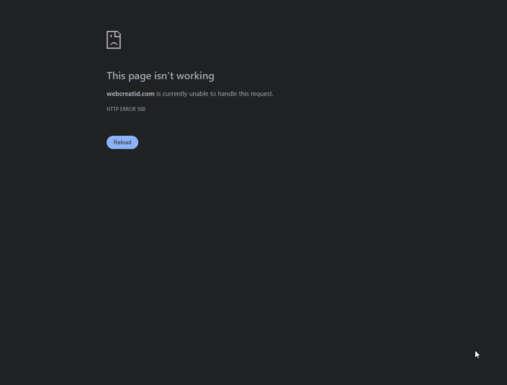

<p align="center">
  
</p>

<h1 align="center">📸 Snap2Link</h1>

<p align="center">
  <strong>Paste screenshots into Claude Code, Cursor, or any terminal AI, in one keystroke.</strong><br/>
  Shortcut, drag a region, and a public share link lands in your clipboard. Done.
</p>

<p align="center">
  <a href="https://snap2link.app"><strong>🌐 snap2link.app</strong></a>
</p>

<p align="center">
  <a href="https://snap2link.app"></a>
  <a href="https://github.com/amys94fr/Snap2Link/releases/latest"></a>
  <a href="https://github.com/amys94fr/Snap2Link/releases"></a>
  <a href="https://github.com/amys94fr/Snap2Link/stargazers"></a>
  <a href="LICENSE"></a>
  <a href="https://github.com/amys94fr/Snap2Link/actions"></a>
</p>

<p align="center">
  
</p>

---

## Why Snap2Link?

You're working with Claude Code, Cursor, or ChatGPT in a terminal, maybe on a remote VPS, maybe locally, and you need to show the model a UI bug, a design mockup, an error screen. The usual workflow is painful: screenshot, save, open the browser, upload to Imgur or Drive, copy the link, paste it. Every single time.

**Snap2Link collapses that whole sequence into one keystroke.** Press your shortcut, drag a region, and a public link is already in your clipboard, ready to paste straight into your AI prompt.

You choose where captures go:

- **Snap2Link hosting** (default): nothing to set up and no account needed. Links expire on their own after 24 hours. A free account, with an email code or Google, keeps them for 48 hours, gives 20 captures a day and 6 links at once, and lets you keep the ones that matter.
- **Your own Google Drive**: captures stay in your Drive, with access limited to the files Snap2Link creates, and old ones are cleaned up after 30 days by default.

No telemetry, no monthly fee.

### Screenshots without the clutter

Developers, support teams and designers receive screenshots all day from clients and colleagues. Each one lands in the phone's gallery, the Downloads folder or the chat, and stays there long after the bug is fixed. A Snap2Link capture arrives as a link instead: the receiver opens it in the browser, on a phone or a computer, and nothing is saved on their device. The same link works on every device, since the capture lives in the cloud, and it expires on its own. Only the sender needs Snap2Link.

## ✨ Features

|  |  |
| --- | --- |
| 🤖 **Built for AI workflows** | Paste screenshots into Claude Code, Cursor, ChatGPT, Aider, or any tool that accepts an image URL |
| 🔌 **Reads links over SSH** | The Snap2Link MCP server lets Claude Code and opencode see the image itself, even on a remote machine |
| 🖱️ **Region, screen or window** | Drag a region with a live size readout, take the screen under the mouse, or pick a window. `R` / `F` / `W` switch, `Esc` cancels |
| ⌨️ **Up to 3 shortcuts** | Default `Ctrl + Print Screen`. Each shortcut has its own capture mode and next step: ask, share at once, or annotate |
| ✏️ **Annotator** | Pen, rectangle, circle, arrow, text and blur before sharing |
| ⚡ **Instant share link** | Upload, make public, copy, all in the background, under a second on broadband |
| 🗂️ **History** | Every link of your host with its thumbnail and time left: copy, delete, view full size, or keep it so a new capture or the cleanup leaves it alone |
| 👤 **Online account** | With a Snap2Link account, [snap2link.app/account](https://snap2link.app/account/) shows your links, devices and profile from any browser |
| ☁️ **Your choice of host** | Snap2Link hosting with or without an account, or your own Google Drive with the `drive.file` scope |
| 🌍 **20 languages** | Follows your system language, with right-to-left layouts for Arabic, Hebrew and Persian |
| 🖥️ **Cross-platform** | Windows, macOS and Linux from a single codebase, native everywhere |
| 🚀 **Built-in auto-updater** | Signed updates pulled from GitHub Releases: Settings, then Check for updates |
| 🪟 **Start with your OS** | Toggle it in Settings, so a capture is always one keystroke away |

## 🚀 Quick Start

```bash
# 1 · Install (see Installation section for your OS)

# 2 · Launch: captures go to Snap2Link hosting, nothing to set up
#     (or pick Google Drive in the wizard and grant access in your browser)

# 3 · Press the shortcut, drag a region, paste anywhere
```

That's it. Three steps, zero configuration.

## 📦 Installation

### Windows

**Via winget** *(recommended, Windows 10+)*

```powershell
winget install snap2link
# or, fully qualified:
winget install amys94fr.Snap2Link
```

**Direct download**: grab the `.exe` installer from the [Releases page](https://github.com/amys94fr/Snap2Link/releases/latest). Until Windows code signing is in place, SmartScreen may flag it as an *"unrecognised app"*: click **More info → Run anyway**. See the [code signing policy](#code-signing-policy).

### macOS

Download the universal `.dmg` from the [Releases page](https://github.com/amys94fr/Snap2Link/releases/latest), open it, and drag Snap2Link into Applications. A single binary runs natively on both Apple Silicon and Intel.

The app is **not yet notarised**, so macOS blocks the first launch. To allow it:

1. Open Snap2Link from Applications once, then close the warning (choose *Done*, not *Move to Trash*).
2. Open *System Settings → Privacy & Security*, scroll down to *Security* and click **Open Anyway** next to Snap2Link. The button shows for about an hour after the blocked launch.
3. Confirm with *Open*, and enter your password if asked. Later launches behave normally.

On macOS 14 Sonoma and earlier, Control-click (or right-click) the app in Finder and choose *Open* instead. macOS 15 Sequoia removed that shortcut.

The first capture asks for **Screen Recording permission**: *System Settings → Privacy & Security → Screen & System Audio Recording* (*Screen Recording* on macOS 13 and 14, *System Preferences → Security & Privacy* on macOS 12). Turn on Snap2Link and re-launch it.

### Linux

**One-liner install** *(recommended)*

```bash
curl -fsSL https://raw.githubusercontent.com/amys94fr/Snap2Link/main/scripts/install.sh | bash
```

The script detects your distro, picks the right package (`.deb`, `.rpm`, or `.AppImage` as fallback), downloads it from the [latest release](https://github.com/amys94fr/Snap2Link/releases/latest), and installs it. Read it before running if you'd like — it's [in the repo](scripts/install.sh).

**Manual install** — grab the file you want from the [Releases page](https://github.com/amys94fr/Snap2Link/releases/latest):

```bash
# Debian/Ubuntu (resolves dependencies automatically)
sudo apt install ./snap2link_*_amd64.deb

# Fedora/RHEL
sudo dnf install ./snap2link-*.x86_64.rpm

# Any distro (AppImage — portable, no install needed)
chmod +x snap2link_*_amd64.AppImage
./snap2link_*_amd64.AppImage
```

The system tray icon requires `libayatana-appindicator3-1`, which is preinstalled on most desktop environments.

### Uninstall

- **Windows**: *Settings → Apps → Installed apps → Snap2Link → Uninstall*, or `winget uninstall amys94fr.Snap2Link`.
- **macOS**: quit Snap2Link from the menu bar, then drag it from Applications to the Trash.
- **Linux**: `sudo apt remove snap2link` (`.deb`), `sudo dnf remove snap2link` (`.rpm`), or delete the AppImage. The install script puts it in `~/.local/bin/snap2link.AppImage`.

Settings and sign-in tokens stay in a `Snap2Link` folder: `%APPDATA%\Snap2Link` on Windows, `~/Library/Application Support/Snap2Link` on macOS, `~/.local/share/Snap2Link` on Linux. Delete it to remove them too. Captures on Snap2Link hosting expire on their own, and you can delete your account from the app or from [your account page](https://snap2link.app/account/).

### Build from source

You'll need [Rust](https://rustup.rs/) (stable), [Node.js 20+](https://nodejs.org/), and the Tauri CLI (`cargo install tauri-cli --version "^2"`).

```bash
git clone https://github.com/amys94fr/Snap2Link
cd Snap2Link
pnpm install
pnpm tauri dev         # hot-reload dev build
pnpm tauri build       # produces a signed installer in src-tauri/target/release/bundle/
```

### opencode

To let opencode read your links, even over SSH or in a VM, run:

```bash
opencode mcp add snap2link --url https://i.snap2link.app/mcp
```

See [integrations/opencode](integrations/opencode) for the optional skill and details.

### Claude Code plugin

To let Claude Code read your links directly, even over SSH, type this at its prompt:

```text
/plugin install snap2link --marketplace amys94fr/Snap2Link
```

See [integrations/claude-code](integrations/claude-code) for details. To run everything on your own machine, with a notification when you paste a link, install [Snap2Link local](integrations/claude-code-local) instead.

## 💡 Use Cases

- **AI prompts**: paste the link directly into Claude Code, Cursor, ChatGPT, or Aider when you need visual context
- **Client feedback without the clutter**: ask clients to send screenshots as Snap2Link links, and read them on any device without filling your phone or your Downloads folder
- **Bug reports**: capture the broken UI, paste the link in Jira or GitHub Issues
- **Design feedback**: share mockup snippets in Slack, Discord or Notion in seconds
- **Documentation**: drop image links straight into READMEs, blog posts, support tickets
- **Remote support**: guide a colleague through their screen without launching a screen-share session
- **Meeting notes**: snap a slide, link it next to your notes, move on with the meeting

## 🔧 Configuration (Google OAuth)

**End users have nothing to configure.** Snap2Link hosting works out of the box. If you choose Google Drive, the app opens Google's consent page in your browser; pick your account and you're done.

**For developers / forks** wanting to ship under their own OAuth credentials:

1. Create a project on [console.cloud.google.com](https://console.cloud.google.com/)
2. Enable the **Google Drive API**
3. Credentials → Create OAuth client → **Desktop application**
4. Download the JSON, rename it `credentials.json`, drop it at the repo root *(gitignored)*
5. `pnpm tauri build`

Snap2Link only requests the minimum scopes:

| Scope | Why |
| --- | --- |
| `drive.file` | Read/write **only the files Snap2Link itself creates** — never the rest of your Drive |
| `userinfo.email` | Display the connected account in Settings (so "Switch Account" makes sense) |

## 🛣️ Roadmap

- ✅ Region capture · clipboard · tray · auto-updater · winget
- ✅ **Cross-platform**: Windows, macOS, Linux
- ✅ **In-app annotations** before upload: pen, rectangle, circle, arrow, text, blur
- ✅ **Full-screen and window capture** alongside region selection
- ✅ **Up to 3 shortcuts**, each with its own mode and next step
- ✅ **Snap2Link hosting**, with or without a free account
- ✅ **20 languages**, right-to-left included
- ✅ **History page** with kept links, and an **online account** at snap2link.app
- ✅ **MCP server and Claude Code plugin** to read links over SSH
- 🔜 **Google Drive links on the online account**
- 🔜 **Paid plans** with longer-lived links
- 🔜 **More clouds**: Dropbox, OneDrive, S3-compatible
- 🔜 **Signed Windows installers**
- 🔜 **macOS notarisation**, then a Homebrew cask
- 🔜 **Scoop** package

Got an idea? [Open an issue](https://github.com/amys94fr/Snap2Link/issues/new) — I read every one.

## 💖 Sponsor

If Snap2Link saves you time in your AI workflow, consider sponsoring its
development on [GitHub Sponsors](https://github.com/sponsors/amys94fr).
Even $3/month covers the cost of code-signing certificates and keeps
the project actively maintained.

A huge thank you to everyone who supports the work.

## 🤝 Contributing

PRs welcome. Quick start for contributors:

```bash
git clone https://github.com/amys94fr/Snap2Link
cd Snap2Link
pnpm install
pnpm test                            # frontend tests (Vitest)
cd src-tauri && cargo test --lib     # app backend tests (Rust)
cd relay && pnpm test                # Snap2Link hosting tests (Cloudflare Worker)
cd android && ./gradlew testDebugUnitTest   # Android app tests (Kotlin)
```

CI ([`test.yml`](.github/workflows/test.yml)) runs on every push and PR — tests must stay green for a merge.

The full guide (bug reports, feature proposals, coding style, PR checklist) is in **[CONTRIBUTING.md](CONTRIBUTING.md)**. For the release procedure (signing, manifest, GitHub release, winget bump), see **[docs/RELEASE.md](docs/RELEASE.md)**.

### Project layout

```
src/                       React + TypeScript interface
  windows/                   SetupWizard · Settings (and settings/ pages) · Overlay · Annotator · Toasts · About
  components/                AnnotatorCanvas · HotkeyRecorder · RetentionControl · UpdateChecker
  i18n/                      i18next + 20 locales
  store/                     Zustand state
  lib/                       Config helpers · KeyboardEvent ↔ Tauri shortcut format

src-tauri/                 Rust backend (Tauri v2)
  src/commands/              account · auth · config · drive · guest · history · relay · screenshot · updater · upload
  src/hotkey.rs              Global shortcut registration
  src/tray.rs                System tray icon and menu
  src/toast.rs               "Link copied" message

relay/                     Snap2Link hosting: Cloudflare Worker (D1, R2) at i.snap2link.app
integrations/              Claude Code plugin, local version, and opencode setup
android/                   Android app (Kotlin, Jetpack Compose): share an image, get its link
```

## Code signing policy

Windows installers are not code-signed yet. SignPath Foundation, which signs open source projects for free, asks for more public visibility than Snap2Link has today, so the project will apply again later. The release workflow is ready to sign through SignPath as soon as it's enabled.

- Committers and reviewers: [amys94fr](https://github.com/amys94fr)
- Approvers: [amys94fr](https://github.com/amys94fr)

Only installers built by this repository's GitHub Actions from its own source are signed, and each signing is approved by hand. Snap2Link sends data only to the services you choose or that keep it working, listed with what they receive in the [privacy policy](https://snap2link.app/privacy/). Full policy: [snap2link.app/code-signing](https://snap2link.app/code-signing/).

## 📄 License

[MIT](LICENSE) © 2025 [Steven Abittan](https://github.com/amys94fr).

Built with [Tauri v2](https://v2.tauri.app/), [Rust](https://www.rust-lang.org/), [React](https://react.dev/), [Tailwind CSS](https://tailwindcss.com/), [Cloudflare Workers](https://workers.cloudflare.com/) and [Vitest](https://vitest.dev/).
